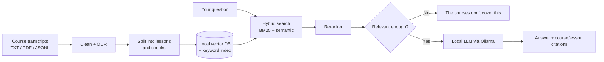

# Ask the Courses You Bought

**Turn the courses you bought into a private AI you can ask anything. It answers only from your course material, shows exactly which course and lesson each answer came from, and runs fully offline on your own computer.**

> **Status:** Phase 1 in progress. Follow along or star the repo to see it come together.

---

## The Problem

People spend real money on online courses from Udemy, Coursera, Skillshare, or independent creators. After a while they own dozens of them, which adds up to hundreds of hours of video.

When a question comes up, like *"How do I write a good hook?"*, they have three bad options:

- **Rewatch everything.** That takes hours, and you still might miss the one lesson that mattered.
- **Ask a general chatbot.** It answers from the whole internet, not from the courses you paid for, and it sometimes makes things up confidently.
- **Give up** and never use most of what you bought.

The knowledge is there. It just isn't **searchable, connected, or trustworthy**.

## The Solution

A local AI "brain" built only from your own course library:

| What you get | Why it matters |
|---|---|
| **Answers only from your courses** | No internet knowledge mixed in, so you get what *your* teachers taught |
| **Course and lesson citations** | Every point shows where it came from, so you can verify it yourself |
| **"The courses don't cover this"** | Honest when the answer isn't in your material, instead of a made-up one |
| **Cross-course answers** | Pulls from every relevant course and shows where they **agree** and **disagree** |
| **100% offline** | Runs on your computer. Your paid content never goes to the cloud |
| **Works with any platform** | Drop in transcripts from any course and re-index |

### Example

```
You:  How do I write a good headline?

AI:   Across 3 courses, the main ideas are:
      - Speak to one specific reader, not everyone
        Source: Scientific Advertising, Lesson 5: Headlines
      - Lead with a concrete benefit or a number
        Source: [Course B], Lesson 2
      Where they disagree: [Course A] favours long, detailed headlines,
        while [Course C] argues for short ones.
```

---

## How It Works



1. **Ingest:** course text is cleaned, OCR'd if it's a scanned PDF, split into lessons, and chunked. Every chunk keeps its course and lesson metadata.
2. **Index:** chunks are stored in a local vector database plus a keyword (BM25) index.
3. **Retrieve:** your question runs through hybrid search, and a reranker picks the most relevant passages.
4. **Ground:** if nothing relevant enough is found, the system says so instead of guessing.
5. **Answer:** a local LLM writes the answer using only the retrieved passages and cites each source.

---

## Tech Stack

| Layer | Tool |
|---|---|
| Local LLM | [Ollama](https://ollama.com) (Qwen 2.5 / Llama 3.1, 7-8B) |
| Embeddings | `bge-m3` / `nomic-embed-text` |
| Vector DB | ChromaDB (local, no server) |
| Keyword search | BM25 (`rank_bm25`) |
| Fusion | Reciprocal Rank Fusion |
| Reranker | `BAAI/bge-reranker-v2-m3` |
| Orchestration | LangGraph (cross-course mode) |
| OCR | `ocrmypdf` / `docling` |
| Interface | Open WebUI |
| Language | Python 3.11+ |

---

## Demo Dataset

So anyone can try it without uploading their own courses, the repo includes a **21-course demo library** built from **public-domain** advertising, copywriting, and sales classics (for example, Claude Hopkins' *Scientific Advertising*, 1923).

- Each **book** becomes a **course**, and each **chapter** becomes a **lesson**.
- One course is a **scanned PDF**, used to exercise the OCR pipeline.
- Everything is stored as JSONL with course and lesson metadata.

```json
{
  "chunk_id": "hopkins_sci_adv-L05-003",
  "course_id": "hopkins_sci_adv",
  "course_title": "Scientific Advertising",
  "lesson_number": 5,
  "lesson_title": "Headlines",
  "text": "...",
  "source_type": "text"
}
```

> **Note:** No paid or copyrighted course content is included in this repo. To use your own courses, add your own transcripts locally (see `scripts/add_course.py`).

---

## Roadmap

### Phase 1: Core System (in progress)

**Data**
- [ ] Build the 21-course public-domain demo dataset
- [ ] OCR and cleanup pipeline for scanned PDF courses
- [ ] Lesson splitting and chunking with full course/lesson metadata

**Retrieval**
- [ ] Local vector index (ChromaDB) and BM25 keyword index
- [ ] Hybrid search with Reciprocal Rank Fusion
- [ ] Reranker for final passage selection

**Answering**
- [ ] Grounded answers via local LLM (Ollama) with citations
- [ ] "The courses don't cover this" fallback based on relevance threshold
- [ ] Cross-course mode: search each course separately, then show agreement and disagreement
- [ ] Short framework summary for each course

**Interface and Workflows**
- [ ] Open WebUI integration
- [ ] Saved workflows: *critique my ad*, *find angles for this product*, *compare what the courses say about X*

**Quality and Docs**
- [ ] Evaluation set of 20+ questions, including uncovered and multi-course ones, with published results
- [ ] One-command setup guide
- [ ] `add_course.py` script to add new courses later

### Phase 2: Future Research

Ideas to explore once the core system is solid:

- **Better grounding:** claim-level citation checking, so every sentence is verified against its source passage
- **Smarter retrieval:** compare chunking strategies (semantic, lesson-aware, hierarchical) and query rewriting
- **Knowledge graph layer:** link concepts across courses (e.g., "hook", "headline", and "attention") for richer cross-course answers
- **Contradiction detection:** automatically surface where teachers disagree, not only when asked
- **Video and audio ingestion:** transcribe courses directly with local Whisper and jump to the exact timestamp
- **Evaluation framework:** automated faithfulness and relevance scoring (RAGAS-style) to track every change
- **Personal learning layer:** quizzes, spaced repetition, and "what haven't I studied yet?" from your own library
- **Lighter hardware:** smaller quantized models and benchmarks for laptops without a GPU
- **Multilingual courses:** ask in one language, answer from courses in another

---

## Project Structure (planned)

```
ask-the-courses-you-bought/
├── data/
│   ├── raw/            # original public-domain sources
│   ├── clean/          # cleaned text, one file per lesson
│   └── dataset/        # courses.jsonl, chunks.jsonl
├── scripts/
│   ├── 01_download.py
│   ├── 02_ocr.py
│   ├── 03_split_lessons.py
│   ├── 04_build_jsonl.py
│   └── add_course.py
├── src/
│   ├── ingest/         # chunking + indexing
│   ├── retrieval/      # hybrid search + reranker
│   ├── generation/     # grounded answering + citations
│   └── graph/          # cross-course LangGraph workflow
├── eval/               # test questions + results
└── README.md
```

---

## Getting Started

> Setup instructions will be added as Phase 1 lands. The goal is a single command that installs everything and indexes the demo library.

---

## Contributing

Ideas, issues, and PRs are welcome, especially around retrieval quality, evaluation, and new public-domain course sources.

## License

MIT

---

Built by [Chetan Padhen](https://github.com/Chetax)
